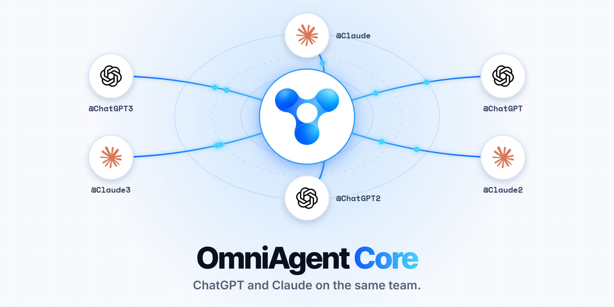
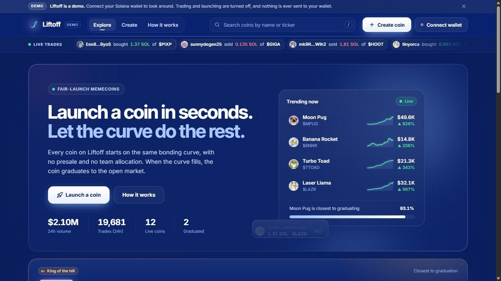
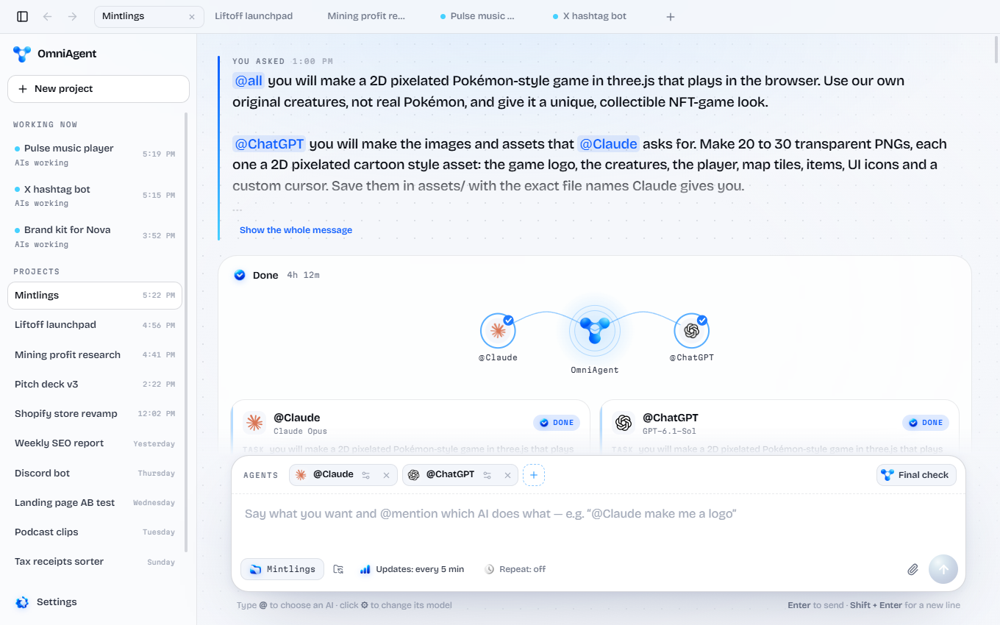
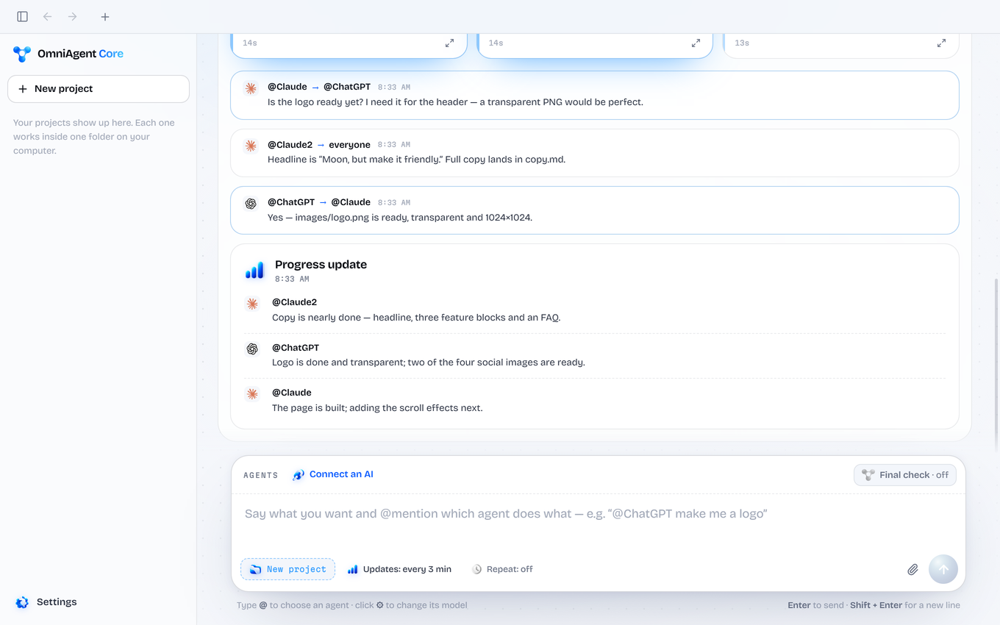
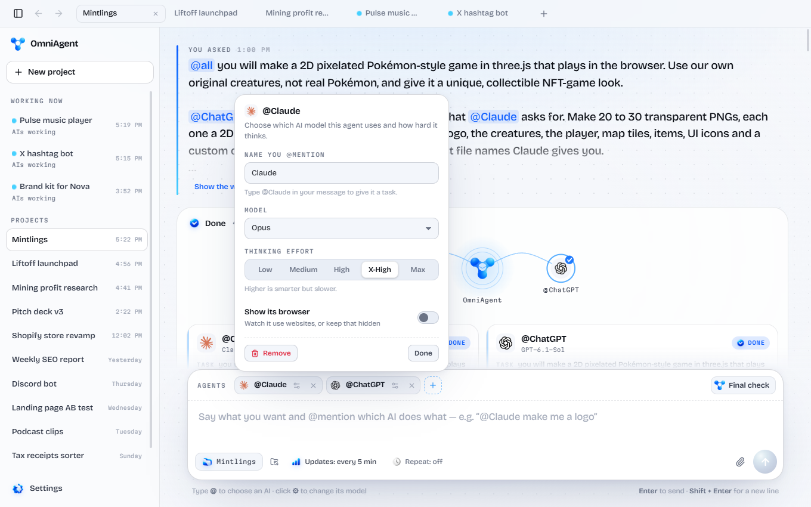
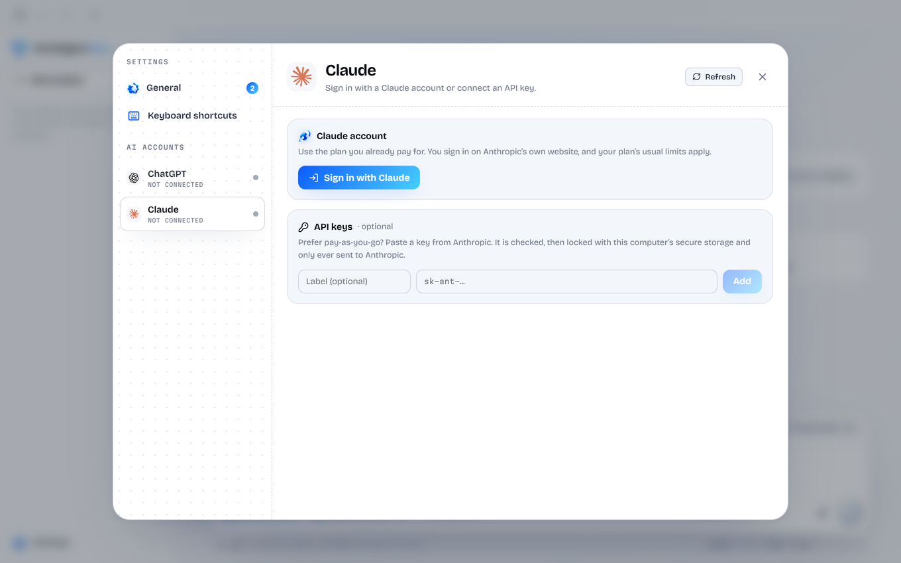
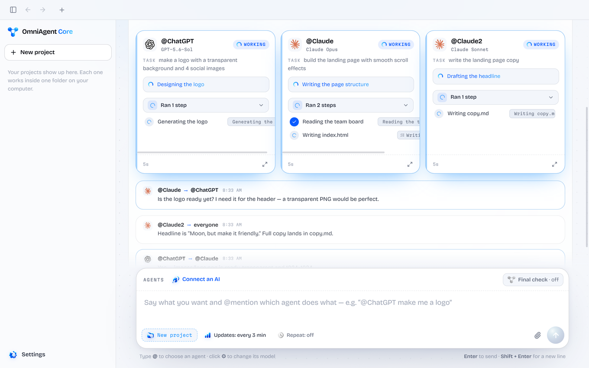
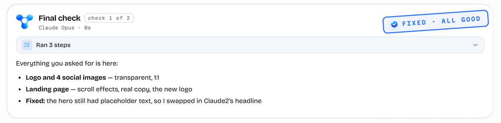

<p align="center">
  <a href="https://omniagenthq.com">
    <picture>
      <source media="(prefers-color-scheme: dark)" srcset=".github/assets/hero-dark.png">
      
    </picture>
  </a>
</p>

<h3 align="center">Claude can't draw. ChatGPT can.<br>Tag them both in one message and they build it together.</h3>

<p align="center">
  <a href="#download"></a>
  <a href="#run-it-from-source"></a>
  <a href="LICENSE"></a>
  
  <a href="https://x.com/OmniAgentHQ"></a>
</p>

<p align="center">
  <a href="https://omniagenthq.com"><b>Website</b></a> &nbsp;·&nbsp;
  <a href="#how-it-works"><b>How it works</b></a> &nbsp;·&nbsp;
  <a href="#built-with-omniagent"><b>Projects</b></a> &nbsp;·&nbsp;
  <a href="#inside-the-app"><b>Inside the app</b></a> &nbsp;·&nbsp;
  <a href="#run-it-from-source"><b>Run from source</b></a> &nbsp;·&nbsp;
  <a href="#questions"><b>FAQ</b></a>
</p>

<br>

## Download

OmniAgent Core is free. It uses the ChatGPT and Claude plans you already pay for.

| Platform | Works on | Download |
| :--- | :--- | :--- |
| **Windows** | Windows 10 or 11, 64-bit | <a href="https://github.com/OmniAgentHQ/OmniAgent/releases/latest/download/OmniAgent-Win64.exe"></a> |
| **macOS Apple Silicon** | M1 or newer | <a href="https://github.com/OmniAgentHQ/OmniAgent/releases/latest/download/OmniAgent-Mac-Silicon.dmg"></a> |
| **macOS Intel** | Older Macs | <a href="https://github.com/OmniAgentHQ/OmniAgent/releases/latest/download/OmniAgent-Mac-Intel.dmg"></a> |
| **Linux** | Ubuntu, Debian, Fedora, Arch, 64-bit | <a href="https://github.com/OmniAgentHQ/OmniAgent/releases/latest/download/OmniAgent-Linux.sh"></a> |

<details>
<summary><b>Install and uninstall steps</b></summary>

<br>

**Windows.** Double-click the file. If Windows warns you, click **More info**, then **Run anyway**. Click **Install**, then open it from the Start menu. To uninstall, open Settings, go to Apps, then Installed apps, find OmniAgent Core and click Uninstall.

**macOS.** Open the `.dmg` and drag OmniAgent Core to Applications. If macOS blocks it the first time, go to System Settings, then Privacy & Security, and choose **Open Anyway**. To uninstall, drag it from Applications to the Trash.

**Linux.** Run the installer, then open OmniAgent Core from your apps:

```bash
bash ~/Downloads/OmniAgent-Linux.sh
```

To uninstall:

```bash
bash ~/.local/share/omniagent-core/uninstall.sh
```

</details>

<br>

## How it works

Tag your agents in one prompt. They talk to each other and get it done.

> **@ChatGPT** make me a logo, **@Claude** build the website.

Each agent is the real thing. OmniAgent connects straight to your own ChatGPT and Claude accounts or API keys, so you use the usage you already have. Your agents ask each other for files, share decisions while they work, and report back as they go.

Need more hands? Add the same AI as many times as you like. **@Claude2** can write the copy while **@Claude** builds the page.

### Agents work better together

Claude built the same racing game twice. Once alone, once with ChatGPT.

<table>
  <tr>
    <th width="50%" align="center">Claude alone</th>
    <th width="50%" align="center">Claude with ChatGPT</th>
  </tr>
  <tr>
    <td></td>
    <td></td>
  </tr>
</table>

<br>

## Built with OmniAgent

Each one started as one message to a team of agents. Open a project to see the full prompt and copy it.

<table>
  <tr>
    <td width="50%" valign="top">
      <a href="https://omniagenthq.com/omniagent-project-racing/"></a>
      <h3>Roadster</h3>
      A 3D racing game that runs in the browser, with nitro boosts, traps and a desert highway at sunset. Claude built the game and ChatGPT made the art.
      <br><br>
      <a href="https://omniagenthq.com/omniagent-project-racing/"><b>See the project →</b></a>
    </td>
    <td width="50%" valign="top">
      <a href="https://omniagenthq.com/omniagent-project-launchpad/"></a>
      <h3>Liftoff</h3>
      A polished launchpad front end from one prompt. Claude named it, designed it and built it. ChatGPT made the logo, coin icons and badges. It's a demo on sample data.
      <br><br>
      <a href="https://omniagenthq.com/omniagent-project-launchpad/"><b>See the project →</b></a>
    </td>
  </tr>
</table>

<p align="center"><a href="https://omniagenthq.com/#results"><b>See every project on the website →</b></a></p>

<br>

## Inside the app

Your whole AI team in one window.

<table>
  <tr>
    <td width="50%" valign="top">
      
      <h3>Switch projects like browser tabs</h3>
      Every project opens as a tab. See which ones your AIs are working on right now, jump between them, and pick any of them up later. Each one lives in its own folder.
    </td>
    <td width="50%" valign="top">
      
      <h3>Progress updates</h3>
      Every few minutes each AI tells you what it finished and what's next, on a timer you choose. Step away, come back, and catch up in one glance.
    </td>
  </tr>
  <tr>
    <td width="50%" valign="top">
      
      <h3>Tag agents. Then tweak them</h3>
      Every @ has its own settings. Pick the exact model and how hard it thinks, add the same AI twice for different jobs, or turn on its browser so you can watch.
    </td>
    <td width="50%" valign="top">
      
      <h3>Log in or paste a key. That's it</h3>
      Log in or use API keys for ChatGPT and Claude. Choose the latest models and set how hard each one reasons. Keys stay locked on your computer.
    </td>
  </tr>
  <tr>
    <td width="50%" valign="top">
      
      <h3>They use your computer</h3>
      Your AIs come with MCP tools: they can open a browser, click, type, read and write files, and run what they build to check it works. You see every step as it happens.
    </td>
    <td width="50%" valign="top">
      
      <h3>Who decides it's done? You do</h3>
      You pick the model that runs the final check. It reviews everything against your request, fixes what's missing or sends work back, then stamps it.
    </td>
  </tr>
</table>

<br>

## Run it from source

You need [Node.js](https://nodejs.org) 24 and [Git](https://git-scm.com). On macOS and Linux you also need a C++ compiler, because the database module is compiled for Electron during install.

```bash
git clone https://github.com/OmniAgentHQ/OmniAgent.git
cd OmniAgent
npm install
npm run electron:dev
```

The app opens with hot reload for the interface. The first start downloads Electron, so give it a minute. Then sign in to ChatGPT or Claude under **Settings**.

<details>
<summary><b>Project layout</b></summary>

<br>

| Folder | What's in it |
| :--- | :--- |
| `electron/` | The main process. `orchestrator.ts` runs the team, `providerRuntime.ts` runs ChatGPT and Claude and their tools, `connections.ts` handles sign-in and keys. |
| `src/` | The React interface. |
| `native/` | Helpers for controlling the desktop on Windows, macOS and Linux. |
| `scripts/` | Build steps and the installers. |

In development, the engines come from `node_modules`: `@openai/codex` for ChatGPT and `@anthropic-ai/claude-code` for Claude.

</details>

<details>
<summary><b>Desktop control</b></summary>

<br>

Chat, teamwork, files and the browser work straight away. Agents clicking inside other desktop apps needs a small helper:

| Platform | Command | Needs |
| :--- | :--- | :--- |
| Windows | `npm run build:runtime` | Python 3.12 |
| macOS | `npm run build:helper` | Xcode Command Line Tools |
| Linux | Nothing to build | `python3` |

</details>

<details>
<summary><b>Build the installers</b></summary>

<br>

Each one is written to `Installers/`, and each has to be built on its own platform.

| Platform | Command |
| :--- | :--- |
| Windows | `npm run build:runtime` once, then `npm run package:core:win` |
| macOS | `npm run package:core:mac` |
| Linux | `npm run package:core:linux` |

</details>

<br>

## Core or Pro

This repo is OmniAgent Core, and it's open source. OmniAgent Pro is a separate app that adds more AIs to the same team.

| | **OmniAgent Core** | **OmniAgent Pro** |
| :--- | :---: | :---: |
| ChatGPT and Claude | ✓ | ✓ |
| Agents that talk to each other | ✓ | ✓ |
| A final check on every project | ✓ | ✓ |
| Gemini, Grok, Muse, DeepSeek, Mistral, Kimi and Qwen | | ✓ |
| Free offline models through Ollama | | ✓ |
| Open source | ✓ | |
| Price | Free | One-time burn of 5,000 $OMNI |

<p align="center"><a href="https://omniagenthq.com/#pro"><b>Compare them on the website →</b></a></p>

<br>

## Questions

<details>
<summary><b>How much does it cost?</b></summary>
<br>
Core is free. Each agent needs a paid plan, like ChatGPT Plus or Claude Pro, or an API key. If one runs out, log out in the app and log back in with another account that still has usage.
</details>

<details>
<summary><b>How is this different from OpenRouter?</b></summary>
<br>
OpenRouter and other AI hubs send each message to one model at a time, so your agents never talk to each other or work on the same project. OmniAgent connects straight to your own Claude and ChatGPT accounts or API keys, so you use the usage you already have.
</details>

<details>
<summary><b>Does it increase AI usage?</b></summary>
<br>
Barely. OmniAgent adds about 2,500 tokens to each agent so it knows its team and its tools.
</details>

<details>
<summary><b>Can it control my computer?</b></summary>
<br>
Yes. Agents can open your browser, click, type, read and write files, and run what they build. You can watch every step and stop them at any time.
</details>

<details>
<summary><b>Is my data safe?</b></summary>
<br>
Everything stays on your computer. API keys are locked in your computer's secure storage and only sent to the company they belong to.
</details>

<details>
<summary><b>Where do I get API keys?</b></summary>
<br>
You don't need them if you log in with a ChatGPT or Claude account. If you'd rather use keys, get them at <a href="https://platform.openai.com/api-keys">platform.openai.com</a> and <a href="https://platform.claude.com">platform.claude.com</a>, then paste them into Settings under AI accounts.
</details>

<br>

## License

OmniAgent Core is released under the [MIT License](LICENSE).

OmniAgent is an independent project and isn't affiliated with OpenAI or Anthropic. ChatGPT, Claude and their logos belong to their owners. By using the app you agree to the [terms](https://omniagenthq.com/terms/).

<br>

<p align="center">
  <a href="https://omniagenthq.com"><b>omniagenthq.com</b></a> &nbsp;·&nbsp; <a href="https://x.com/OmniAgentHQ"><b>@OmniAgentHQ</b></a>
</p>
